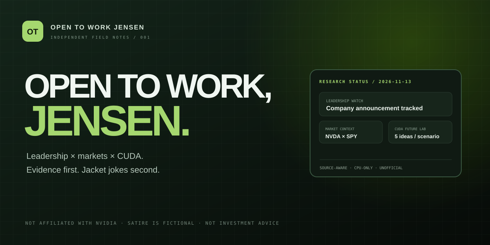
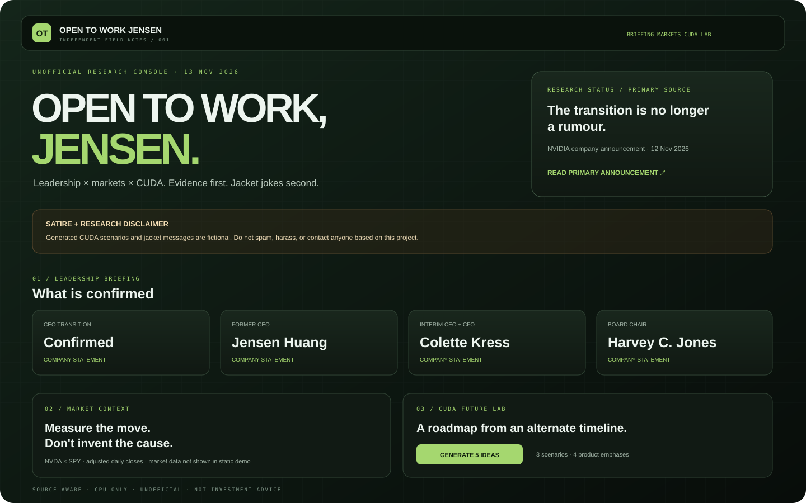

  

<h1 align="center">open-to-work-jensen</h1>

<strong>A source-aware NVIDIA leadership research console with NVDA market context, a hypothetical CUDA roadmap lab, and an affectionate jacket satire generator.</strong>

  
  
  
  
  

<a href="https://voyager67.github.io/Open-To-Work-Jensen/">Live browser demo (after Pages deployment)</a> · <a href="#quick-start">Quick start</a> · <a href="CONTRIBUTING.md">Contributing</a>

> **Satire notice:** CUDA scenarios and jacket messages are fictional. They are not NVIDIA announcements, forecasts, insider claims, or statements about any real person's employment or intentions. **Do not spam, harass, or contact anyone based on this project.**
>
> Unofficial and unaffiliated with NVIDIA. Market information is for research and education only, not investment advice.

---

## What it does

Open-To-Work-Jensen is a compact research workspace for separating company statements, regulatory material, external coverage, and market data—without pretending a headline explains a stock move or that an internet rumour is a fact.

| Module | Capability |
|---|---|
| **Leadership Watch** | Dated, source-linked context and RSS/Atom headline metadata. |
| **Evidence labels** | Publisher-host classification for company, regulatory, media/aggregator, and external sources. |
| **NVDA Market Pulse** | Adjusted NVDA and SPY closes, normalized performance, daily returns, and dated event windows. |
| **CUDA Future Lab** | Five hypothetical feature ideas across three leadership-style scenarios and four product emphases. |
| **Jacket Office** | Affectionate, explicitly fictional open-to-work and jacket-parody messages. |
| **Browser demo** | Interactive scenario and satire generators in plain HTML, CSS, and JavaScript. |
| **Dry-run CLI** | Local preview requiring an explicit dry-run flag; no network or external actions. |

## Interface preview

The browser demo is self-contained. The Python dashboard adds the public-feed reader and NVDA-versus-SPY charts.

## Quick start

### 1. Generate a local preview in seconds

Python 3.10+ only. No GPU, CUDA runtime, API key, account, network, or package install is required for this command.

    python -m otwj --dry-run

Choose a scenario and focus:

    python -m otwj --dry-run --scenario engineering_led --focus "Developer experience" --satire "Open-to-work card"

Structured JSON output:

    python -m otwj --dry-run --json

### 2. Run the full research dashboard

    git clone https://github.com/voyager67/Open-To-Work-Jensen.git
    cd Open-To-Work-Jensen
    python -m venv .venv

    # macOS / Linux
    source .venv/bin/activate
    # Windows PowerShell
    # .venv\Scripts\Activate.ps1

    python -m pip install -r requirements.txt
    streamlit run app.py

No NVIDIA GPU is needed. If a feed or market-data provider is unavailable, its panel reports the error rather than inventing headlines or prices.

### 3. Open the browser demo

Open the docs/index.html file directly, or enable GitHub Pages with **GitHub Actions** as the deployment source. Once the repository is public and Pages is enabled:

    https://voyager67.github.io/Open-To-Work-Jensen/

## Example dry-run output

    OPEN TO WORK JENSEN — DRY RUN (LOCAL PREVIEW ONLY)
    Scenario: Engineering-led continuity | Focus: Developer experience

    HYPOTHETICAL CUDA FEATURES
    1. Kernel Observatory — A profiler connects source lines, launch geometry, occupancy, and hardware counters.
    2. Portable CUDA Graphs — Better capture diagnostics and portability checks across supported GPU generations.
    3. Async Memory Contracts — Static and runtime checks for copies, barriers, and buffer lifetimes.
    4. Compiler Feedback API — Structured optimization remarks for IDEs and CI.
    5. Open Kernel Test Corpus — A versioned suite with correctness and performance baselines.

    SATIRE PREVIEW
    OPEN TO WORK (FICTIONAL THOUGHT EXPERIMENT)
    Role: Chief Kernel Whisperer.
    Availability: hypothetical. CUDA skills: very real.
    Please do not contact anyone on my behalf.

    No posts, messages, network requests, or external actions were made.

## Sources and methodology

| Purpose | Source | Use |
|---|---|---|
| Company statements | [NVIDIA Newsroom RSS](https://nvidianews.nvidia.com/cats/press_release.xml) | Press-release metadata and primary links. |
| Investor disclosures | [NVIDIA SEC filing RSS](https://investor.nvidia.com/rss/SECFiling.aspx?Exchange=CIK&Symbol=0001045810) | Regulatory filing metadata. |
| External coverage discovery | [Google News RSS](https://news.google.com/rss/search?q=NVIDIA+Jensen+Huang+CEO+succession&hl=en-US&gl=US&ceid=US:en) | Headline and publisher discovery, not independent verification. |
| Market context | Yahoo Finance via [yfinance](https://github.com/ranaroussi/yfinance) | Adjusted daily closes for NVDA and SPY; unofficial and potentially delayed. |
| Dated context anchors | data/context_events.json | Manually reviewed dated company statements with primary links. |

**Collection guardrails:** Streamlit usage-statistics telemetry is disabled in the project config. Each feed request has a seven-second timeout and 1 MB response cap; requests are spaced at least 1.25 seconds apart; feed results are cached for 15 minutes and market data for one hour in Streamlit. Only headline metadata, publisher, timestamps, short summaries, and source links are shown. Article pages are not scraped or republished. Feed failures are isolated.

Respect each source's terms. NVIDIA's [RSS directory](https://www.nvidia.com/en-us/about-nvidia/rss/) describes informational use and restricts commercial reuse; review the terms before reusing feeds elsewhere.

### Evidence model

Publisher labels describe where a link points, not whether every claim in an article is true. The dashboard does not calculate rumour scores, rank alleged successors, infer private intentions, treat headlines as company announcements, or attribute stock moves to nearby headlines.

The market panel rebases adjusted NVDA and SPY closes to 100. Dated items align to the first available trading session on or after the event date and compare the prior close with that session. This is descriptive timing context—not an event study, causal model, or investment signal.

## Architecture

    Public RSS / Atom ──> bounded reader ──> attribution + topic labels ──> source briefing
    Yahoo Finance ──────> NVDA / SPY normalization ───────────────────────> market context
    Dated source links ─> event-date alignment ───────────────────────────> market context
    Scenario templates ─> CUDA Future Lab
    Local templates ────> Jacket Office

The CLI and browser demo use deterministic templates. The Streamlit dashboard adds the feed and market adapters.

## Project layout

    .
    ├── .github/                 # CI, Pages deployment, Dependabot, issue templates
    ├── data/context_events.json # Reviewed dated source anchors
    ├── docs/                    # Browser demo and SVG artwork
    ├── .streamlit/config.toml   # Disables Streamlit usage telemetry
    ├── otwj/                    # CLI, feed reader, signals, generators, market adapter
    ├── tests/                   # Deterministic unit tests
    ├── app.py                   # Streamlit research dashboard
    ├── CONTRIBUTING.md
    ├── CITATION.cff
    ├── LICENSE
    ├── pyproject.toml
    ├── requirements.txt
    └── SECURITY.md

## Tests

    python -m compileall -q app.py otwj tests
    python -m unittest discover -s tests -v

The suite covers deterministic generators, explicit dry-run safety, RSS/Atom parsing, URL validation, feed limits, DTD/entity rejection, failure isolation, safe rendering of untrusted headlines, publisher labels, and event-date return alignment. GitHub Actions tests Python 3.10, 3.11, and 3.12.

See [CONTRIBUTING.md](CONTRIBUTING.md) and [SECURITY.md](SECURITY.md). Original code is MIT licensed. NVIDIA names and marks, third-party feeds, market data, headlines, and linked articles remain subject to their owners' rights and terms.

---

Built for transparent public-source research and harmless satire. No automated outreach, no secret sauce, no releases.
